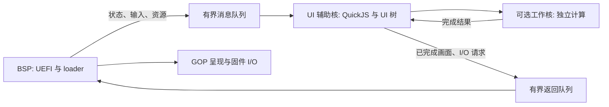

# 引导优先与多核运行架构

> [!NOTE]
> 状态：设计。AP 调度、消息队列和固件 I/O 适配尚未实现。

目标：UEFI 和 loader 引导主路径运行于 BSP；在固件支持的情况下，让独立辅助核运行 PocketJS，其他工作核按需处理计算任务。BSP
应优先推进系统引导，界面异步跟随。

该调度目标适用于 `boot` 和 `recovery` 场景。`charging` 场景保持电源管理与低功耗优先，允许降低 UI
帧率、减少工作核和息屏；入口定义见 [entry-modes.md](entry-modes.md)。

## CPU 分工

| 执行位置    | 职责                                                                    |
| ----------- | ----------------------------------------------------------------------- |
| BSP         | 引导状态机、内核/文件加载、固件调用、输入采集、有限的显示提交和退出协调 |
| UI AP       | 独占 QuickJS 实例、页面逻辑、UI 树和该实例的分配器；生成完整的显示提交  |
| 可选工作 AP | 解码、校验等独立计算，不直接修改活的 UI 树或同一个 QuickJS 实例         |

UEFI 不提供操作系统式的进程优先级调度。任务分工通过 CPU 归属、队列、预算和协作实现。主线程使用 BSP 不等于 BSP 一定是大核：核类型、当前
BSP、MP Services 或平台 AP 启动能力需要逐机核验，不能承诺在任意固件上把主执行核切换到指定的大核。

## 数据与 I/O

BSP 将输入和引导状态写入有界队列；UI 核在帧边界消费。普通进度可以只保留最新值，关键控制消息另有明确的完成确认。队列饱和时不能让 loader 等待 UI
空出队列；需要丢弃可合并的界面更新或暂时停止更新画面。

UI 核提交服务拥有的完成缓冲区，BSP 在引导预算允许时呈现。缓冲区通过明确的所有权交接移转，禁止一边扫描/复制一边覆盖；默认用 staging
buffer。直接跨核写 GOP 显存属于后续需核验映射和一致性的优化。

所有固件调用集中在 BSP，辅助核请求分配、文件、输入等服务时通过队列发送。UI 使用预留 arena，不能在 AP 的分配路径中偷偷回退到固件
AllocatePool。JS 中的 I/O 必须采用异步响应或已缓存资源，不反向阻塞引导线程。

独立工作任务不能持有可变 UI 状态；结果在 UI 核提交。并行光栅化不是现有渲染器自动具备的能力，需要另外处理绘制顺序、裁剪和缓冲区所有权，不能直接把上游
draw list 任意拆分到多个核。

## 引导优先的实际边界

BSP 不同步等待 UI
帧完成，画面可以降帧或暂时保留上一帧。辅助核线程数、帧率和工作量设预算，减少共享内存带宽与缓存争用。大文件加载/内核验证等引导阶段可进一步降低或暂停界面任务。

这种设计以引导优先为目标；多核仍共享内存系统、功耗和固件资源，必须实测引导耗时才能判断影响，不能仅凭“用了其他核”宣称引导时间绝不增加。

## 生命周期与兼容

合作 loader 通过驻留服务接续控制权，后台 UI 的原实例继续存在。非阻塞的提交、完成查询、取消和暂停/停止确认需要进一步扩展当前最小请求
ABI，不能把现有 `PUMP` 名称当作已经实现的跨核调度器。

进入不认识本协议的 loader 前，先完成辅助任务暂停并回收对显示和固件资源的访问权；返回后重新检查 GOP 模式，再恢复任务。保持后台 UI
持续运行仅适用于明确接入本协议的 loader。

启动内核前停止调度、收回进行中的 I/O 和显示工作、按平台要求归还 AP，再取得最终内存映射并调用 ExitBootServices。不能把还运行着、仍访问
Boot Services 内存的辅助任务交给不知情的内核。最终 GetMemoryMap 和退出之间不得再进行会改变内存映射的分配/释放。

若固件无 AP 能力，降级为 BSP 上有预算的协作 UI；必要时只保留静态启动画面。上述 AP 架构是目标设计，当前尚未实现，也未在任何目标固件上验证。
