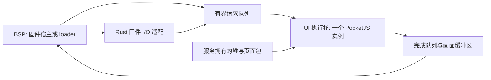

# PocketJS for Boot 整体设计

> [!NOTE]
> 状态：固件服务仍为设计。ABI、默认页面和通用嵌入式中间件已有实现；本页的 EFI 服务及多核流程描述目标架构。

## 范围

目标是在同一次 UEFI 启动中运行 PocketJS 图形服务，让合作的 loader 接续已初始化的引擎，并重新加载用户上下文。普通 loader
可以忽略自定义配置表条目。

公开接口包含堆范围、实例指针和单个调用入口。原服务继续拥有内部 Rust/QuickJS
对象；消费者通过调用入口使用它们。接口细节见[交接协议](uefi-handoff.md)。

自研 ABI、驻留服务、平台适配、存储和调试通道采用 Rust，C 头文件从 Rust 生成。上游 QuickJS 与官方 guest 仍包含 C。
单片机与固件共享的 `no_std + alloc` 执行层见[嵌入式中间件](embedded-runtime.md)，BSP 负责 C 库兼容与设备接入。

## 宿主集成

服务计划由 EFI Boot Service Driver，或仍保持装载的父 EFI 应用承载。生产者通过
`InstallConfigurationTable` 发布实例信息，消费者按 GUID
发现服务。发布配置表不会自动固定映像寿命，所有者需要维持代码、回调和实例依赖。

固件阶段与 loader 阶段都需要明确的 BSP I/O 泵送位置。驱动返回后仅留下配置表，不足以保证固件自动调度页面。接入方式由 `role`
决定，页面业务由 `scene` 决定；具体预设见[入口与运行场景](entry-modes.md)。

页面和资源可打包为 `.pocket`，存放在 ESP 或独立 FAT32 内容分区。首次读取后由服务保留稳定字节，loader
接续时复用已加载资源。分区与包加载约定见 [用户层存储与调试](userspace.md)。

## 内部架构

BSP 推进引导或平台状态机，集中处理固件调用。固件支持 AP 时，一个 UI 核独占 QuickJS 和可变 UI 状态，其他工作核按需执行独立计算。无 AP
能力时，在 BSP 采用有预算的协作执行，必要时只保留静态画面。

`boot` 与 `recovery` 优先推进主路径；`charging` 优先处理电源管理与低功耗。 UI
通过有界队列异步跟随，进度允许合并、画面允许降帧。任务预算、缓冲区所有权和退出协调见[引导优先与多核](architecture.md)。模块职责见[模块说明](modules.md)。

## 生命周期

1. 所有者预留服务内存，读取包并初始化一次 PocketJS，再发布配置表。
1. 合作的消费者发现兼容实例并获取租约，通过原入口操作页面。
1. 消费者交还租约，下一阶段接续同一实例与堆。进入不合作的 loader 前停妥辅助任务与显示访问，返回后重新检查设备状态。
1. 启动内核前停止服务、归还 AP，并在最终内存映射前完成必要的撤表与清理。
1. `ExitBootServices` 成功后，旧实例调用契约结束。

以上是服务的设计流程。当前 `pjb_call` 只做消费端校验和转调，尚未实现租约、初始化、停止或队列调度语义。

## 限制与待验证项

| 项目        | 当前边界                                       |
| ----------- | ---------------------------------------------- |
| 执行环境    | 面向 UEFI；BIOS 与独立 U-Boot 后端尚未实现     |
| CPU 分工    | BSP 是否为大核、AP 启动能力与拓扑须按固件核验  |
| 引导耗时    | 共享缓存、内存和功耗仍可能带来开销，需要测量   |
| charging    | 电源数据、PMIC 与保护策略依赖平台后端          |
| loader 兼容 | 忽略 GUID 可继续启动；实例接续需要主动接入协议 |
| 状态保留    | 限于同一次启动及 Boot Services 生命周期        |

## 验证

已完成宿主 ABI 编译、布局、互调，以及真实 QuickJS/官方 guest 的用户 context 替换与像素输出测试；步骤分别见
[入门与宿主验证](getting-started.md)和[嵌入式中间件](embedded-runtime.md)。EFI 服务实现后，需要使用两个独立
EFI 消费者确认引擎实例地址连续、引擎初始化计数不增加、用户上下文与旧句柄按阶段更换，并验证租约、未知 loader 返回、AP 停止及
`ExitBootServices` 边界。平台无关的生命周期与 BSP 接入见[裸机公共层与 BSP](no-std-bsp.md)。
