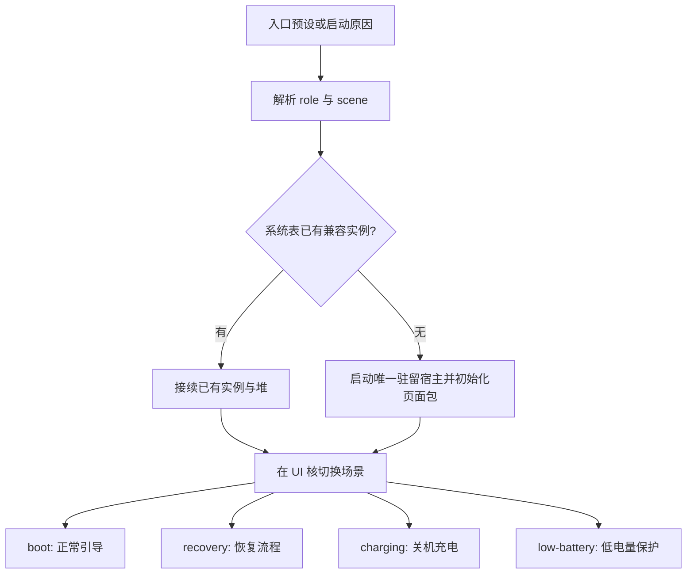

# 入口与运行场景

本页定义入口命名、接入方式和运行场景。

> [!NOTE]
> 状态：入口命名和共享页面已实现，包含低电量保护页。EFI 入口调度、recovery 后端和电源平台驱动尚未实现。

正式名称为 `uefi`、`loader`、`uefi-loader`、`recovery`、`charging`、`low-battery`。文件名和配置使用
`uefi-loader`，界面可以显示“UEFI + Loader”。

## 两个维度，一份运行时

UEFI 本身是固件执行环境，loader 也可以运行在这个环境内。前三个名称描述接入方式，后三个描述业务场景，内部应分别保存，避免为每种组合复制一份引擎。

| 维度             | 值            | 职责                                                                   |
| ---------------- | ------------- | ---------------------------------------------------------------------- |
| 接入方式 `role`  | `uefi`        | 在固件阶段提供/接入驻留 UI 服务；内核装载交给后续 loader               |
| 接入方式 `role`  | `loader`      | 由 loader 集成界面，发现并使用驻留实例；缺失时通过显式服务启动路径创建 |
| 接入方式 `role`  | `uefi-loader` | 我们的一体入口同时承担服务宿主和 loader 控制，复用同一个实例           |
| 运行场景 `scene` | `boot`        | 普通启动界面、启动项和引导进度                                         |
| 运行场景 `scene` | `recovery`    | 恢复界面、诊断和恢复后端入口                                           |
| 运行场景 `scene` | `charging`    | 不启动主系统的充电界面，固件仍运行                                     |
| 运行场景 `scene` | `low-battery` | 黑底纯图形的低电量保护，不自动进入系统                                 |

对外仍可保留用户指定的六个入口预设：

| 入口          | 默认接入方式       | 默认场景      |
| ------------- | ------------------ | ------------- |
| `uefi`        | `uefi`             | `boot`        |
| `loader`      | `loader`           | `boot`        |
| `uefi-loader` | `uefi-loader`      | `boot`        |
| `recovery`    | 由产品接入配置决定 | `recovery`    |
| `charging`    | 由产品接入配置决定 | `charging`    |
| `low-battery` | 由产品接入配置决定 | `low-battery` |

`recovery`、`charging` 与 `low-battery` 沿用同一产品的宿主方式：既可以由固件阶段进入，也可以由 loader
进入。角色不因切换页面而自动改变；六个预设最终都转换成一个内部 `EntryConfig { role, scene, boot_reason, ... }`。

## 启动与复用流程

role 和 scene 不写进 GUID。它们共用既定 GUID，运行时继续拥有堆、资源和调用入口。发现兼容服务就复用，不能因为进入
recovery/charging/low-battery 再初始化一份 QuickJS，也不能覆盖仍活跃的配置表条目。

优先把四种场景放在同一个 `.pocket` 包中，通过明确的场景切换事件更新页面和原生服务能力。切换页面可以重建页面节点，但保持 JS
引擎、堆管理和宿主服务存活。若产品确实需要不同页面包，则按显式包切换处理，页面状态迁移单独约定。

当前配置表 ABI 只有最小实例接续操作。场景通知、启动请求、电源状态等消息仍需在 Rust 中定义和生成接口，本文件没有把它们当作现有可调用功能。

## 三种接入方式的边界

`uefi` 模式需要明确的固件阶段接入点，或一个仍在执行、负责 BSP I/O 泵送的 EFI 宿主。普通 Boot Service Driver
发布服务后返回，并不意味着任意固件都会替它持续处理 UI 队列；不能据此承诺不修改宿主就能一直刷新固件阶段的画面。

`loader` 模式通过生成的头文件/函数指针接入。消费端自己的启动逻辑继续控制内核和其他 EFI 程序的加载；PocketJS 只接收状态和提交请求，UI
不接管引导主线程。

`uefi-loader` 模式由同一产品入口协调宿主和引导状态机。可以组合链接相同的 Rust 模块，不需要再创建第二个运行时。若宿主放在 EFI
应用映像中，应用保持装载；返回固件前必须停妥任务、撤销配置表引用并处理资源，不能留下指向已卸载映像的入口。

## recovery 场景

提供恢复菜单、诊断信息以及调用已适配恢复后端的入口。实际磁盘检查、文件修复、刷写等能力属于对应 Rust/平台后端；已有 UI 和 `.pocket`
文件不会自动产生这些能力。

有两条可选路径：在当前 UEFI 服务中执行已适配的恢复工具，或链式启动独立 recovery loader/内核。后者跨越 ExitBootServices
时结束当前 PocketJS 服务；进入恢复操作系统后若还使用 PocketJS，需要该环境自己的宿主，不能继续调用旧 UEFI 实例。

## charging 场景

关机充电表示保持在固件阶段、不进入主操作系统。它展示外部电源、电池电量、充电状态和必要提示；电量、温度等数据缺失时明确表示不可用，不捏造数值。

数据由 Rust 电源适配层或已有固件提供。实际充电控制、电池保护、温度策略和 PMIC 驱动由平台负责；JS 页面不直接操作电源寄存器。目标 UEFI
是否提供足够信息需要按设备核验，没有通用保证所有机器都能读到电量百分比。

电源键/明确的启动请求可在平台条件满足时切到 `boot`；进入主系统前复用同一个 UI
实例。拔线、低电量或其他电源事件如何处理，由平台策略决定，界面不写死全设备通用的开关机规则。

charging 以电源管理和低功耗优先：降低动画帧率、允许息屏、减少工作核活动。没有引导任务时不为追求帧率让大核和全部辅助核持续忙碌。BSP 上处理必要固件
I/O，UI 核仍独占 JS；具体休眠/唤醒能力和 AP 数量取决于固件。

## low-battery 场景

默认页面为纯黑背景，只显示电池与接电图形，不显示文字、百分比、顶底栏或设置，不接受页面内启动操作。 该页无循环动画，BSP 可降低刷新频率；接电状态和电量通过
`PowerState` 更新。进入保护、恢复 boot、延时关机与电池阈值由 BSP 决定，页面不自行解除保护。 boot 和 recovery
则在顶栏显示电量百分比。具体接口见[默认页面](default-ui.md#%E7%94%B5%E9%87%8F%E4%B8%8E%E4%BD%8E%E7%94%B5%E9%87%8F%E4%BF%9D%E6%8A%A4)。

## 调度与选择来源

`boot` 和 `recovery` 遵循引导/恢复主路径优先，界面异步跟随；`charging` 遵循电源管理优先。公共的多核与队列约定见
[architecture.md](architecture.md)。

接入方式由部署配置/宿主身份决定；场景可以来自本产品自己的 EFI
LoadOptions、配置文件、启动按键或平台启动原因。只解析属于我们入口的选项格式，不改写其他 loader
的参数格式。明确指定的入口与平台要求如何排序，需要在设备策略中统一定义。

入口配置解析器和场景切换消息仍待实现；本页中的流程为目标行为。
