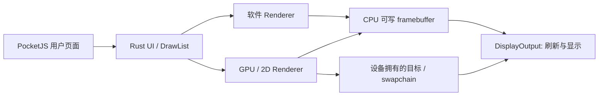

# 裸机显示、framebuffer 与硬件加速

本页说明共享中间件如何连接普通 framebuffer、UEFI GOP 和裸机加速器。单片机是可用环境之一，中间件不按板型选择渲染方式。

> [!NOTE]
> 状态：已接入上游 Renderer、DisplayOutput 和
> Coordinator。宿主测试覆盖真实软件像素及模拟异步加速器的生命周期；尚未实现或验证特定 GPU、blitter 或板级显示控制器驱动。

## 格式、渲染与输出

RGB565、RGBA8888 和 ARGB8888 描述像素怎样存储，不决定使用 CPU 还是硬件加速，也不限定是否运行在单片机。 32 位 ARGB8888
在小端内存中是 BGRA 字节顺序。实际格式和 stride 来自 BSP 探测到的显示设备。



| 场景                | Renderer                           | DisplayOutput 与目标                             |
| ------------------- | ---------------------------------- | ------------------------------------------------ |
| 普通裸机 fb         | 上游软件 raster                    | 已映射的 CPU 可写 framebuffer，描述格式和 stride |
| UEFI GOP            | 软件 raster，或 BSP 另行提供加速器 | 固件 framebuffer 或 BSP 的 GOP Blt 输出适配      |
| 带 2D 加速的裸机 fb | BSP 的 blitter/DMA2D 等 Renderer   | CPU 可见目标，返回前完成所有写入                 |
| 带 GPU 的裸机       | BSP 的 GPU Renderer                | 设备目标句柄、交换缓冲、提交与 fence，可延迟完成 |
| 小屏或面板 GRAM     | 软件或硬件 Renderer                | BSP 负责条带缓冲、DMA、局部刷新与面板传输        |

GOP 提供显示能力，不保证提供可调用的 GPU 绘制接口。GPU、blitter、显示控制器、DMA 和缓存维护归 BSP 移植；核心复用同一份
DrawList 和资源契约。

## 已实现接口

[`output.rs`](../crates/embedded-runtime/src/output.rs) 复用上游类型，没有另造板型枚举或图形命令集：

| 接口                  | 职责                                                           |
| --------------------- | -------------------------------------------------------------- |
| `Renderer`            | 读取 DrawList、字体和纹理，提交绘制，等待完成并回收 submission |
| `DisplayOutput`       | 描述设备，获取目标，刷新、等待传输及提供缓冲身份               |
| `Target::CpuVisible`  | 独占的 CPU 可写区域，含格式、物理矩形和 stride                 |
| `Target::DeviceOwned` | 设备目标句柄，核心不解引用，也不强制映射到 CPU                 |
| `Coordinator`         | 匹配驱动能力，处理 damage、预算、提交和完成顺序                |

`Config` 只包含逻辑画面、解释器和 CPU framebuffer 预算；不包含像素格式。`PocketJs::new` 不分配像素缓冲。
注册显示之前可以无屏执行。`frame_buffer_budget = 0` 允许设备拥有的目标；该预算只校验 CPU
显示存储，不代替驱动的显存或命令缓冲预算。

## 普通 framebuffer

[`FramebufferDisplay`](../crates/embedded-runtime/src/output/framebuffer.rs)
是可选的直接 framebuffer 适配器，接受调用方的 `Vec<u8>`、`Box<[u8]>` 或独占的
`&'static mut [u8]`，自身不分配像素。 以下函数可以注册 BSP 已映射、可由 CPU 正常写入并且具有一致性的 framebuffer：

```rust,ignore
use pocketjs_embedded_runtime::{Error, PocketJs, output::*};

fn attach_fb(
    js: &mut PocketJs,
    memory: &'static mut [u8],
    width: u32,
    height: u32,
    stride: usize,
    format: PixelFormat,
) -> Result<DisplayId, Error> {
    let display = FramebufferDisplay::new(memory, width, height, stride, format)
        .map_err(|_| Error::InvalidConfig)?;
    js.add_display(display, RendererId::SOFTWARE)
}
```

CPU 输出的物理尺寸须匹配当前逻辑尺寸；此处使用 1:1 像素映射。上游软件 raster 支持 RGBA8888、ARGB8888 和
RGB565，按原生目标分辨率绘制并保留行尾 padding。 其他格式需要支持该格式的 Renderer 或显式转换驱动。

这个直接适配器的 flush/wait 是空操作，适用于已配置好的、一致性 CPU framebuffer。需要 cache clean、DMA、GOP
Blt、页翻转或垂直同步时，BSP 实现或包装 `DisplayOutput`，在其 flush/wait 内完成设备操作。 页表、MMIO
映射、内存属性和显示控制器初始化不由中间件猜测。

## 硬件加速

BSP 实现上游 `Renderer` 和 `DisplayOutput`，再注册到同一个实例：

```rust,ignore
let renderer_id = js.add_renderer(bsp_renderer)?;
let display_id = js.add_display(bsp_display, renderer_id)?;
```

Renderer 的 descriptor 声明支持的像素格式、目标所有权、DrawList 版本、同步方式及是否支持零拷贝；DisplayOutput
声明实际格式、stride、缓冲与刷新能力。 不匹配的组合会在注册时拒绝。设备目标的物理尺寸可以由加速器映射到逻辑视口，核心不需要为其分配同尺寸的 CPU
画面。

CPU 可见目标必须使用 `Immediate`，绘制返回前完成目标写入。设备目标可用 `Deferred`：绘制提交后返回，让引导任务或下一次 JS
更新与设备工作交错执行。 驱动须复制会在调用后失效的命令、字体等数据；声明零拷贝的延迟提交只允许保留契约规定的纹理存储。
中间件使用官方纹理版本保留机制，直到提交退休，避免用户释放或更新纹理时破坏设备读取。

硬件只支持部分操作时，可在 CPU 可见目标上使用上游 `render_operation` 按 DrawList
顺序做软件回退；先排空先前的设备写入并完成缓存同步。 设备私有目标需要驱动支持全部操作或持有自己的 staging 资源。核心不会自动把任意 GPU 目标当作
CPU 指针。

## 调度、换页与交接

`replace_user` 只加载新页面，不自动呈现。`advance(page, input)` 推进脚本与 UI，`present(page)`
提交显示；`tick` 是两者连续执行的便捷方法。 需要优先处理引导时，BSP 可以降低显示频率，或在 advance 与 present 之间执行引导工作。

同步路径依次完成 acquire、render、renderer wait、display flush/wait 和 retire。 延迟路径在下一次
present、显式 `complete_presentation`、页面替换或实例销毁时完成。声明 `queued_flush`
的设备可先提交显示交换，再等待渲染与显示完成。

页面替换先完成旧设备工作，再销毁 JSContext 和 UI 资源；失败会先报告给调用方，不提前释放旧用户层。驱动的 wait
无论成功或失败都必须保证硬件已停止访问相关存储。 引擎和输出驱动在正常换页后继续保留。交出显示设备、停止 AP 或卸载固件服务前调用
`complete_presentation()`；外部修改显示内容后用 `invalidate_outputs()` 使 damage 历史失效。

## 验证

沿用[嵌入式执行层的测试命令](embedded-runtime.md#%E9%AA%8C%E8%AF%81)。新增四项输出测试覆盖：

1. RGBA/ARGB 的带 stride framebuffer、行尾 padding 和分离的更新/呈现。
1. 不分配 CPU framebuffer 的设备目标、延迟提交和 queued flush。
1. 设备读纹理期间用户释放纹理，以及页面替换和 Drop 前的终止等待。
1. 渲染等待失败、目标类型不兼容和 CPU 显示存储预算不足。

真实 QuickJS 和 UI 生成测试 DrawList；异步加速器使用受控模拟驱动验证生命周期。具体硬件加速效果和性能需要在目标 BSP 上测量。
